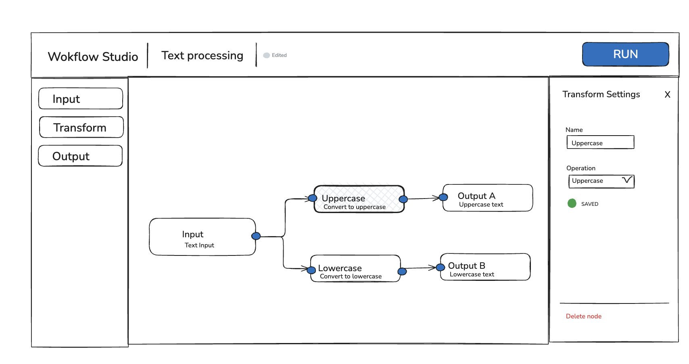
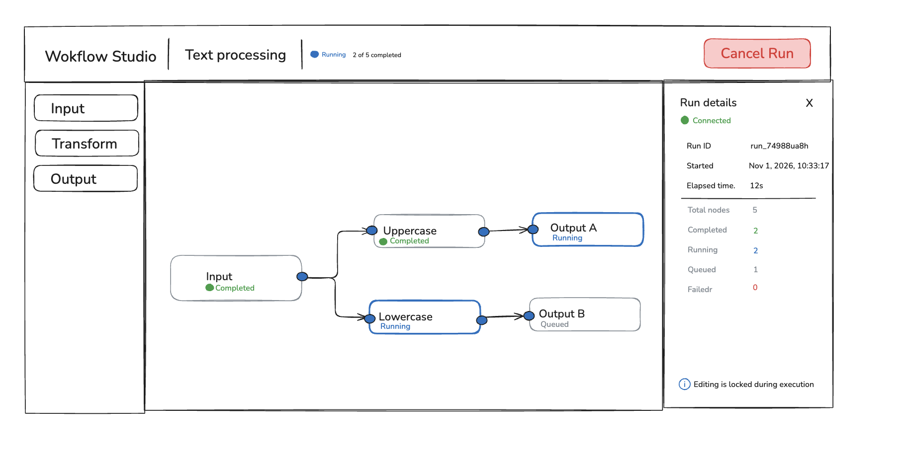

# Workflow Studio

A mini workflow canvas: compose a graph of text-processing steps, run it on a simulated backend, and watch per-node progress stream onto the canvas.

> **Status:** functionally complete (M0–M5). Build a workflow, press Run, and watch each node move through queued → running → succeeded / failed / skipped; cancel mid-run; reload mid-run and it re-attaches. Visual polish was done in hand-directed passes after functionality (DECISIONS #18, #26–29).

## Design sketches

Rough sketches I drew before starting, shared with the agent as the UI brief (AI_NOTES, prompt 1).

| Edit mode — Transform Settings panel | Run mode — Run details panel |
|---|---|
|  |  |

Where the built UI departs from them, each change is a recorded decision:
- The header's "Edited" pill and the per-field "SAVED" indicator became a single "Saved locally" pill; edits autosave locally and the server only sees the workflow on Run (DECISIONS #3).
- "Cancel Run" no longer replaces "Run" in the same spot: Cancel sits beside Run so a late click can't start a new run (DECISIONS #24).
- Nodes use an inverse-colour header with icons, and carry the run status in that header, instead of plain outlined boxes with a status line (DECISIONS #26–28).
- The first-visit example is a single Input → Transform → Output rather than the five-node graph drawn here (DECISIONS #16).

| Milestone | Scope |
|---|---|
| M0 | npm workspaces (`shared`, `server`, `web`), Express, Vitest, docs |
| M1 | Shared contract: Zod schemas, graph validation, text transforms |
| M2 | Canvas editor: React Flow, palette, connect, settings panel, keyboard, localStorage |
| M3 | BFF: accept workflow, simulated DAG executor, SSE, cancel |
| M4 | Live run UI: node status, progress, run details, cancel, editing lock, re-attach |
| M5 | Empty/loading/error gaps, separate Run/Cancel buttons, run shortcut, final docs and verification |

## Setup

Requires Node ≥ 22.12 (Vite 8).

```bash
npm install
```

One command per side, in two terminals:

```bash
npm run dev:server   # Express on http://localhost:3001
```

```bash
npm run dev:web      # Vite on http://localhost:5173 (proxies /api → :3001)
```

Open http://localhost:5173. A first visit loads an Input → Transform → Output example; press **Run** (or ⌘/Ctrl+Enter).

To see failures more often: `FAILURE_RATE=0.5 npm run dev:server` (0–1, default 0.1). `PORT` moves the server; `API_TARGET` points the Vite proxy elsewhere.

From the repo root:

```bash
npm test             # Vitest: shared rules, executor, HTTP/SSE, client reducers
npm run typecheck    # tsc for shared, server, web
npm run lint         # oxlint
```

## Repository layout

```
shared/src/   @wand/shared — Zod schemas + pure logic used by both sides (consumed as TS source, no build step)
  workflow.ts   node/edge/workflow schemas; Transform config discriminated on `operation`
  graph.ts      canConnect() for the canvas, validateWorkflow() → issues tied to a node or edge
  transforms.ts applyTransform(): uppercase, lowercase, normalize, literal replace
  run.ts        run/node statuses, RunSnapshot, RunEvent, applyRunEvent()
  api.ts        response bodies, ApiError
server/src/   @wand/server — Express BFF (run with tsx)
  app.ts        routes + SSE endpoint
  execution.ts  RunExecution: simulated DAG scheduler
  store.ts      in-memory workflows and runs
web/src/      @wand/web — React + Vite + React Flow
  state/        editor reducer, run reducer, useEditor, useRun, localStorage
  api/client.ts fetch commands, responses parsed with shared schemas
  components/   Canvas, WorkflowNodeView, Header, Palette, SidePanel, NodeSettingsPanel, …
```

## Architecture

### Canvas state
Two pieces of client state, deliberately kept apart:

- **Workflow document** (`state/editor.ts`) — a pure reducer holding the `Workflow` exactly as the shared schema defines it, plus UI-only selection. It autosaves to localStorage (schema-validated on load; anything stale or corrupt falls back to the example) and is what gets sent on Run. React Flow nodes are *derived* from it at render time and React Flow's change events are translated back into reducer actions, so React Flow never holds a second copy of the document (DECISIONS #14).
- **Run state** (`state/run.ts` + `useRun.ts`) — a pure reducer (`idle` → `starting` → `active`) that folds the SSE stream with the same `applyRunEvent` the server uses. `useRun` owns every side effect: Run's two POSTs, one EventSource per run, cancel, and reload re-attach. Run state never touches the document, so status updates can't mark it dirty or leak into what is saved or submitted.

Every editor action passes through one gate in `App.tsx`: while a run is starting or running, document changes are dropped (pan, zoom and inspection still work); after a run settles, the first content edit clears its presentation — moving, selecting, pan and zoom don't count as edits (DECISIONS #11, #12, #23).

**Editing feedback.** Settings apply on every keystroke. Invalid values (an empty name, an empty Replace `find`) are kept rather than blocked, and flagged inline under the field, as a badge on the node, and in the workflow panel's "Before this can run" list. Invalid connections are refused while dragging, with a short explanation (DECISIONS #15).

**Why React Flow, and how it scales.** React Flow gives pan/zoom, handles, connection dragging and edge routing for free, which is most of an editor's interaction cost; raw SVG would mean rebuilding that before reaching the interesting parts. The cost is that its node model is not ours, hence the derive-and-translate layer. At demo scale every edit re-maps all nodes and every SSE event re-renders all nodes. For hundreds of nodes I would (1) memoise the Workflow → React Flow mapping per node so untouched nodes keep identity, and (2) move run state into an external store with per-node subscriptions (`useSyncExternalStore` or Zustand), so one node's status change re-renders one node. React Flow can also skip rendering off-screen nodes via `onlyRenderVisibleElements` (not enabled here).

### Validation
`shared/src/graph.ts`, used by the canvas while editing and re-checked by the server on accept (DECISIONS #10, #12):
- **Structural** — no duplicate node/edge IDs, edges to missing nodes, self-connections, duplicate source/target pairs, edges into Input, edges out of Output (Output is terminal), a second incoming edge on a Transform/Output, or cycles.
- **Run readiness** (only checked once the structure is valid) — every node named, every Transform/Output has an incoming edge, Replace `find` non-empty, at least one Input-to-Output path. Dead ends are allowed.

Zod checks shape only; these rules are plain functions returning issues pinned to a node or edge, which is what lets the UI point at the problem and the server return a useful 422 (DECISIONS #13).

### Streaming: why SSE
Progress is one-way (server → client) and commands are plain POSTs, so a bidirectional WebSocket buys nothing here; SSE works through the Vite proxy unchanged and native `EventSource` reconnects by itself. Every connection starts with a full `snapshot`, then numbered `node` / `run` deltas (`id:` = `seq`), so a reconnect re-snapshots instead of replaying a log, and stale deltas are ignored by `seq`. A `: ping` comment every 15 s keeps idle connections alive. The server ends the stream when the run settles and the client closes its EventSource on the terminal event (DECISIONS #7, #20).

### BFF execution model
`server/src/execution.ts` — one `RunExecution` per run, in memory (DECISIONS #2, #19):
- All nodes start `queued`; a node starts when all its upstream nodes have `succeeded`, so independent branches run concurrently.
- Each running node holds a timer (0.5–3 s). On completion it fails with ~10% probability (any node type); otherwise it computes real output: Input emits its text, Transform applies its operation to the upstream output, Output passes it through.
- A failure marks queued descendants `skipped` (with the cause); other branches continue. The run becomes `failed` or `succeeded` only once nothing is queued or running.
- Cancel clears all timers, marks queued/running nodes `cancelled`, leaves settled nodes alone, and is a no-op on a terminal run. Completions only apply to a node still `running`, so late timers cannot overwrite `cancelled`.
- Every change is a numbered `RunEvent` folded into the snapshot with the shared `applyRunEvent`, then fanned out to SSE subscribers.

Accepted workflows are stored as immutable copies, so edits in the browser can never affect a run in flight. Timing and failure are injectable, so tests choose which nodes fail rather than seeding `Math.random`.

### Run experience
- **Header:** Cancel and Run sit side by side in fixed positions, so a late click on Cancel can never land on Run (DECISIONS #24). Run is disabled while a run is in flight or the workflow has issues (with the reason as a tooltip); Cancel is enabled only while a run is in flight. The status pill shows **Pending** until the run is accepted and its first snapshot arrives (Cancel stays disabled then — there is no run ID yet), then `Running · 2 of 5 completed`, then the outcome.
- **Canvas:** each node has an inverse-colour header (icon + name): dark gray while configuring, blue when selected. During a run the header takes the node's status colour and status icon, and the description line becomes colour-coded status text with duration — queued (clock, gray, dimmed), running (spinner, blue), succeeded (check, green), failed (alert, red, with the reason below), skipped (brown, dashed, with the upstream cause), cancelled (gray, dimmed). Output nodes show their result text. Edges animate while their target runs (DECISIONS #28).
- **Side panel:** with nothing selected, Run details shows connection state, run ID, start time, elapsed time and per-status counts. Selecting a node during a run shows its status and output or error, with settings read-only.

### Handling the ugly parts
| Situation | Behaviour |
|---|---|
| **Cancel mid-flight** | Server clears timers and marks queued/running nodes `cancelled`; settled nodes keep their state; late timers cannot overwrite. The cancel response is the current snapshot, applied unless the stream is already ahead. A failed cancel request is shown in Run details and Cancel re-enables. |
| **A node fails while others run** | Its descendants become `skipped` with the cause; independent branches keep running; the run turns `failed` only once nothing is queued or running. |
| **Network blip** | EventSource reconnects by itself; the server sends a fresh snapshot first, so missed events don't matter. The pill and Run details show "reconnecting". |
| **Tab reload mid-run** | The run ID lives in `sessionStorage`; on load the client re-attaches to `/events` and receives the current snapshot (DECISIONS #22). |
| **Run no longer exists** (server restarted) | The stream fails permanently → marked lost; editing unlocks with an explanation instead of staying stuck. |
| **Start fails** (server down, 422) | Banner on the canvas with the reason and any issues; editing stays unlocked. |

## API contract

All routes are under `/api`; bodies are Zod schemas in `shared/src`.

| Route | Request | Success | Errors |
|---|---|---|---|
| `GET /api/health` | — | `200 { ok, service }` | — |
| `POST /api/workflows` — validate and accept a graph snapshot | `Workflow` | `201 { workflowId }` | `400 bad_request` (shape), `422 invalid_workflow` + `issues[]` |
| `POST /api/workflows/:id/runs` — start execution | — | `202 { runId }` | `404 not_found` |
| `GET /api/runs/:id` — latest snapshot | — | `200 RunSnapshot` | `404 not_found` |
| `GET /api/runs/:id/events` — SSE subscription | — | `text/event-stream` of `RunEvent` | `404 not_found` |
| `POST /api/runs/:id/cancel` — cancel | — | `200 RunSnapshot` (unchanged if already terminal) | `404 not_found` |

Every error body is `ApiError { error, message, issues? }`, including malformed JSON (400), unknown `/api` routes (404) and unexpected failures (500 `internal`).

## Decisions & cuts

Chronological log with owner and trade-off for each: [DECISIONS.md](DECISIONS.md). How the agent was used: [AI_NOTES.md](AI_NOTES.md).

**Where the polish line is.** Effort went into what makes a run legible at a glance and the editor hard to break: per-node status on the canvas, live counts, Pending state, validation feedback in three places, explained connection refusals, the editing lock, Run/Cancel in fixed positions, and the reconnect paths. Visual design is deliberately plain and done in hand-directed passes after functionality (DECISIONS #18). The first passes replaced colour coding with a small `lucide-react` icon set for node types, actions and run status, and moved to an inverse-colour node header that carries the status during a run (DECISIONS #26–28).

**Cut:**
- Drag-from-palette — clicking a palette entry adds the node at the viewport centre.
- Minimap, renaming the workflow, undo/redo, multi-select.
- A server production build — the server runs via `tsx` only (no deployment in scope).

Page-reload re-attach started as a cut candidate and was implemented once snapshot-on-connect made it ~10 lines (DECISIONS #22).

## Known limitations

- No database: workflows and runs live in server memory, are never evicted, and vanish on restart; in-flight runs are lost with the process.
- Every edit re-maps all nodes and every SSE event re-renders all nodes — fine for demo-sized graphs, not tuned for hundreds (see "Why React Flow, and how it scales").
- New nodes can land on top of existing ones (placed at the viewport centre with a small cascade).
- localStorage holds one workflow; there is no workflow list.
- Elapsed time compares the server's `startedAt` with the browser clock — fine on one machine; a remote deployment would need server-relative time.
- The production web bundle is a single 528 kB chunk (161 kB gzipped: React, React Flow, Zod, lucide icons); no code splitting.
- Not exercised by hand: a real network drop mid-run (the EventSource reconnect path is implemented and the snapshot logic is unit-tested, but only simulated in the browser).

## With another week

- **Durable execution:** persist the run event log (it is already the source of truth for snapshots) and drive nodes from a job queue instead of in-process timers, so runs survive restarts and can resume; retries per node.
- **Scale to 500-node workflows:** per-node memoised mapping and per-node run-state subscriptions (above); batch SSE deltas per animation frame; a concurrency limit per run on the server.
- **Multiplayer editing:** the document is already a single serialisable value changed by discrete actions, which is the shape a CRDT (e.g. Yjs) or server-ordered operation log needs; selection is already separate, per-user state.
- Run history per workflow, undo/redo (the reducer makes this a history stack), drag-from-palette, and the visual polish pass.
